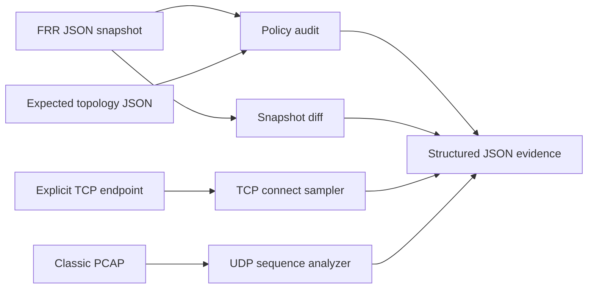

# Architecture and design tradeoffs

## Inputs and trust boundaries

- **FRR CLI JSON**: treat as untrusted external JSON; select only explicit commands `show bgp ipv4 unicast summary json` and `show bgp ipv4 unicast json`. The audit compares observed state with a separate, reviewable inventory.
- **Classic PCAP**: binary input. Validate magic, endianness, timestamps, link-layer type, record length and IPv4/UDP lengths before reading sequence IDs. Unknown variants error explicitly.
- **TCP connect**: user explicitly selects host/port, sample count, interval and timeout. No background process, automatic subnet discovery, scanning or elevated access.

## Why Local Preference is checked

The routing lab's `edge` and `core` use two transit autonomous systems. The expected inventory encodes both the preferred next hop and the minimum Local Preference 200 in each direction, making a failover or policy misconfiguration observable as an audit violation. The returned Local Preference is a BGP attribute, not a latency value.

## Failure semantics

- **0** = passing audit or successfully generated descriptive report.
- **2** = audit failed or one or more TCP connect attempts failed (useful in health checks).
- **1** = malformed input, missing tools, subprocess error, invalid command arguments.

The `bgp-diff` command exits 0 when comparisons are computed, even if network changes are present; a change is not automatically a failure. The operator must decide whether drift is expected.

## Security and operational boundaries

- `bgp-live` runs only read-only `vtysh` show commands through Docker Compose.
- Raw data and generated JSON files may contain sensitive IP layout; `local-evidence` and `local-reports` are excluded by `.gitignore`.
- File parsing performs bounded record-size validation; it is not a security-reviewed, hardened hostile-PCAP parser.
- No management-plane write access and no Windows host routing changes.
